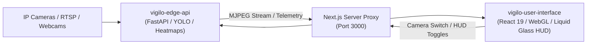

<div align="center">

# Vigilo User Interface (`vigilo-user-interface`)

### Predictive AI Pedestrian Crowd Intelligence & Flow Management — Web Interface

[](https://nextjs.org)
[](https://react.dev)
[](https://www.docker.com)
[](https://tailwindcss.com)
[](https://github.com/oframe/ogl)
[](https://www.typescriptlang.org)

<p align="center">
  <a href="#overview">Overview</a> •
  <a href="#system-architecture">Architecture</a> •
  <a href="#features">Features</a> •
  <a href="#tech-stack">Tech Stack</a> •
  <a href="#getting-started">Getting Started</a> •
  <a href="#docker-deployment">Docker</a> •
  <a href="#configuration">Configuration</a>
</p>

</div>

---

## Overview

**Vigilo User Interface** is the mission-critical, hardware-accelerated frontend application for the **Vigilo** pedestrian crowd intelligence and flow management ecosystem.

Engineered with **Next.js 16**, **React 19**, and **WebGL shaders (OGL)**, it provides transit operators, airport authority personnel, and security operations centers with a real-time command dashboard featuring:
* Real-time MJPEG live vision streaming with zero latency.
* HUD controls for 2D Ground Heatmaps and Density Cluster Polygons.
* In-flight IP camera switching modal (RTSP, HTTP/HTTPS, Webcams, Local presets).
* High-density Bento telemetry grid (pedestrian counts, people/megapixel, spatial proximity, bottleneck forecasts).
* Liquid Glass aesthetic with fluid micro-interactions and animations.

> **Backend Pair**: Connects to [`vigilo-edge-api`](https://github.com/kodo-kaze/vigilo-edge-api), the decoupled FastAPI & YOLO edge ingestion service.

---

## System Architecture



---

## Features

- **Liquid Glass Navigation & HUD**: Sleek, transparent frosted glass panels with spring-physics transitions and responsive mobile drawers.
- **Runtime Camera Source Switcher**: Live modal dialog allowing operators to switch video feeds on-the-fly (Network RTSP/HTTP streams, port selection, local hardware webcams, pre-configured camera presets).
- **Interactive Vision Overlays**: Direct toggling of dynamic 2D ground thermal density heatmaps and density-aware spatial cluster hulls.
- **Telemetry Bento Grid**: Live-updating metrics for scene-level density, person count, nearest-neighbor proximity, bottleneck risk levels, and system health.
- **Biometric-Free Privacy**: Visualizes optical density fields and directional vectors without storing facial signatures or personal identifiable information.

---

## Tech Stack

- **Framework**: [Next.js 16.4.5](https://nextjs.org/) (App Router, Turbopack, Standalone Output)
- **Library**: [React 19.3.0](https://react.dev/)
- **Visual Computing**: [OGL](https://github.com/oframe/ogl) (Ultra-light WebGL library for GPU particle shaders)
- **Styling**: [Tailwind CSS v4](https://tailwindcss.com/)
- **Icons**: [Lucide React](https://lucide.dev/)
- **Language**: [TypeScript 5.x](https://www.typescriptlang.org/)

---

## Getting Started

### Prerequisites
- Node.js 20.x or higher
- npm 10.x or higher
- Backend instance running [`vigilo-edge-api`](https://github.com/kodo-kaze/vigilo-edge-api) (default: `http://localhost:8000`)

### Installation & Run

```bash
# 1. Install dependencies
npm install

# 2. Run the development server
npm run dev
```

Open [http://localhost:3000](http://localhost:3000) with your browser.

---

## Docker Deployment

Build and run with Docker Compose:

```bash
docker compose up -d
```

Or build directly:

```bash
docker build -t vigilo-user-interface:latest .
docker run -d -p 3000:3000 \
  -e INTERNAL_BACKEND_URL="http://host.docker.internal:8000" \
  --name vigilo-user-interface vigilo-user-interface:latest
```

---

## Configuration

Set environment variables in `.env.local` or container environment:

| Variable | Default | Description |
| :--- | :--- | :--- |
| `INTERNAL_BACKEND_URL` | `http://127.0.0.1:8000` | Target URL of the `vigilo-edge-api` service |
| `PORT` | `3000` | HTTP listening port for the web interface |
| `NEXT_TELEMETRY_DISABLED` | `1` | Opt-out of Next.js anonymous telemetry |
